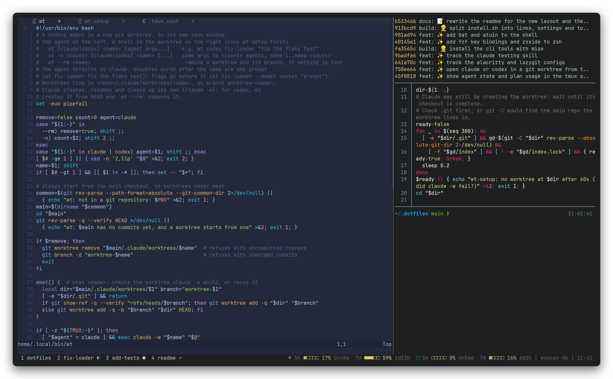
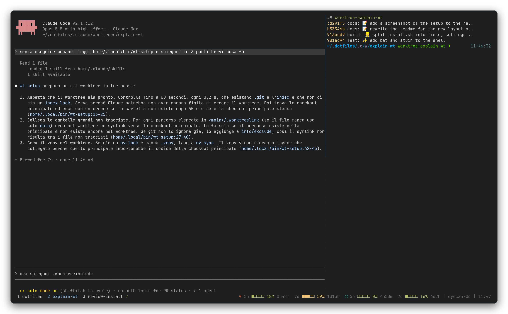
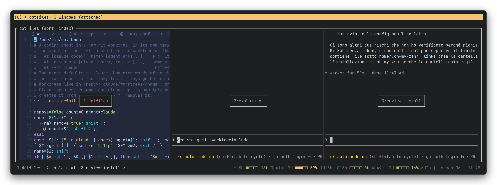

# .dotfiles

My terminal setup: zsh, tmux and Neovim, built around running coding agents
(Claude Code, Codex) side by side, each in its own git worktree.



## Install

```bash
git clone git@github.com:alessioarcara/.dotfiles.git ~/.dotfiles
~/.dotfiles/install.sh
chsh -s "$(which zsh)"
```

> [!NOTE]
> From the package manager it only needs `zsh git curl make gcc xclip unzip jq libnotify-bin`.
> Everything else (Neovim, tmux, fzf, ...) is installed for your user, without sudo,
> so it works the same on a server. Running it again is safe.

## Agents in worktrees

Press `prefix W` (the prefix is `Ctrl-a`) and type a name and a task:

```
worktree: fix-loader fix the flaky test in test_loader.py
worktree: codex fix-loader fix the flaky test in test_loader.py
```

A new window opens with the agent on the left (Claude, or Codex if you ask for
it) and a shell inside the worktree on the right, for tests and `git diff`.
The worktree gets the repo's `data` folder linked in and its own virtualenv.

<table>
  <tr>
    <td width="50%"></td>
    <td width="50%"></td>
  </tr>
  <tr>
    <td align="center">An agent at work, with its worktree shell</td>
    <td align="center"><code>prefix w</code>: every window at a glance</td>
  </tr>
</table>

Each tab shows the agent's state, and a desktop notification tells you when it
needs you:

| ◐ | ● | ✓ | ✗ |
| :---: | :---: | :---: | :---: |
| working | waiting for you | done | error |

The status bar shows how much of the Claude and Codex plans you have used.

> [!TIP]
> From a shell, `wt fix-loader <task>` does the same as `prefix W`, and
> `wt -n 3 refactor <task>` gives the same task to three agents at once.

> [!IMPORTANT]
> When Claude exits (`/exit`) it asks whether to keep the worktree. Codex does
> not, so remove its worktree with `wt --rm fix-loader`.

## Keys

| tmux (`Ctrl-a` …) | | Shell | |
| --- | --- | --- | --- |
| `W` | new agent in a worktree | `Ctrl-r` | search the history |
| `w` | pick a window | `Ctrl-t` | find a file, with preview |
| `\|` `-` | split side by side / stacked | `z <dir>` | jump to a frequent directory |
| `H` `J` `K` `L` · `m` | resize · zoom the pane | `cat` | file with syntax colors |
| `y` in copy mode | copy to the system clipboard | | |

> [!NOTE]
> On a server reached over ssh the tmux prefix becomes `Ctrl-b` and its status
> bar moves to the top, so it can run inside the laptop's tmux.

<details>
<summary><b>Neovim keys</b> (leader is <code>Space</code>)</summary>

| Keys | What it does |
| --- | --- |
| `<leader>pf` · `Ctrl-p` · `<leader>ps` | find a file · a file in git · text in files |
| `gd` · `K` · `[d` `]d` | go to definition · documentation · previous, next error |
| `<leader>vca` · `<leader>vrn` · `<leader>f` | code action · rename · format |
| `Alt-,` `Alt-.` · `Alt-1`…`Alt-5` · `Alt-c` | previous, next tab · go to tab · close tab |
| `Ctrl-h j k l` | move between Neovim splits and tmux panes |
| `<leader>gs` | git (fugitive) |

</details>

<details>
<summary><b>How the repo is organised</b></summary>

| Path | What it is |
| --- | --- |
| `home/` | same layout as your home directory: every file is linked to the same place. Add a file there and run `./install.sh links` |
| `fragments/` | the shareable part of the Claude Code and Codex settings, merged in by `./install.sh settings` (those tools rewrite their own files, so they are not linked) |
| `home/.config/mise/config.toml` | the command-line tools and their versions; `mise upgrade` updates them |
| `~/.zshrc.local` | settings for one machine only, not in the repo |

</details>
